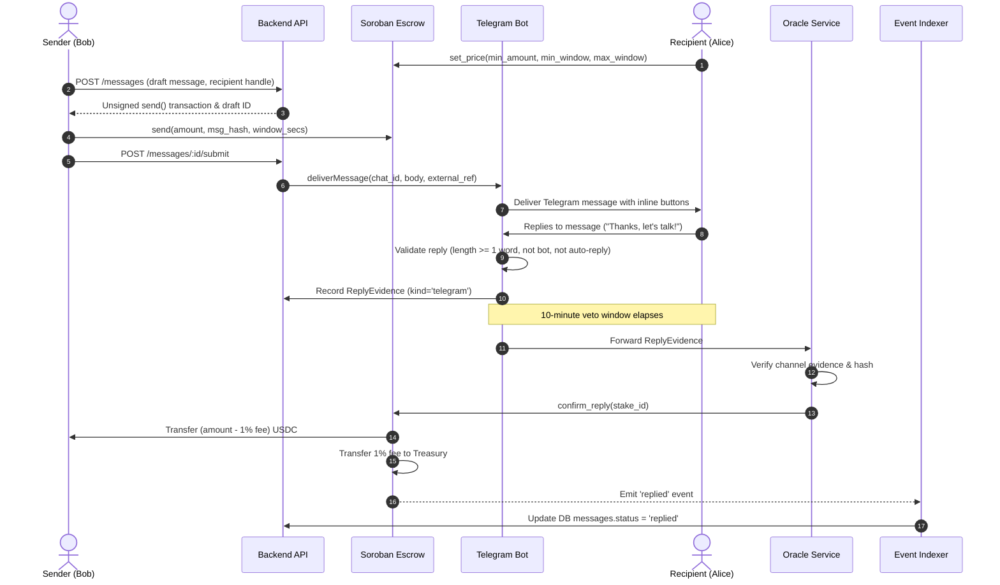
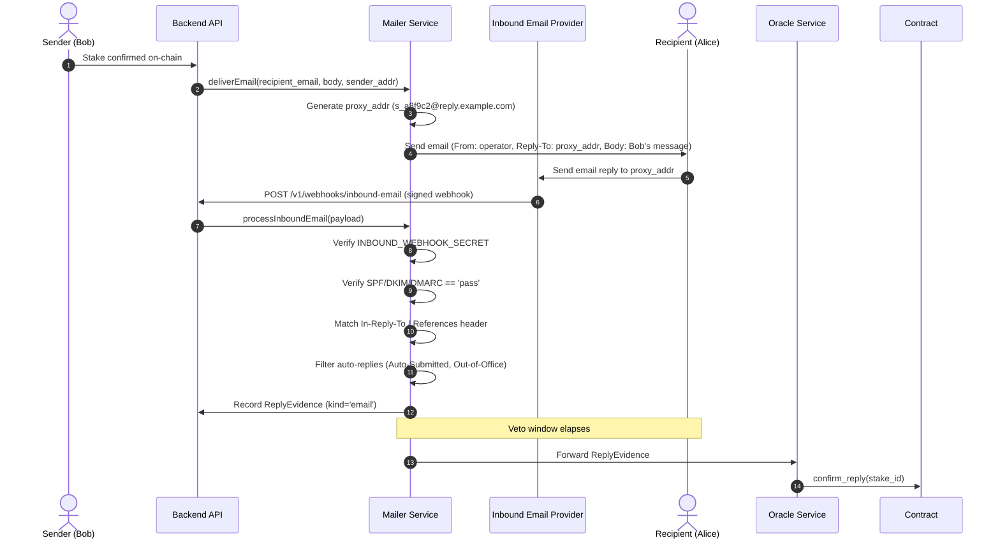

# System Architecture

This document provides a comprehensive technical breakdown of the **Stellar Postage** system architecture, component topologies, data flows, and cross-service interactions, expanding upon the foundational design in `README.md`.

---

## 1. High-Level Component Topology

```
┌────────────────────────────────────────────────────────────────────────┐
│                        Frontend (Next.js App)                          │
│   Recipient Dashboard · Sender Compose & Staking · Live Stake Tracker │
└─────────────────┬───────────────────────────────────┬──────────────────┘
                  │ REST / WebSockets                 │ Stellar SDK (RPC)
                  ▼                                   ▼
┌─────────────────────────────────┐     ┌────────────────────────────────┐
│          Backend API            │     │    Soroban Escrow Contract     │
│   Auth (SEP-10) · Messages DAL  │◄───►│  Stakes · Pricing · Fee Split  │
└───────┬─────────────────┬───────┘     └───────────────▲────────────────┘
        │                 │                             │
        ▼                 ▼                             │ confirm_reply(stake_id)
┌──────────────┐   ┌──────────────┐            ┌────────┴───────────────┐
│  PostgreSQL  │   │   Channel    │            │     Oracle Service     │
│   Database   │   │   Adapters   │── evidence ──►  Evidence Validation │
└──────────────┘   │ Telegram Bot │    queue   │  KMS Signing & Submit  │
                   │ Email Mailer │            └────────────────────────┘
                   └──────────────┘
                          ▲
                          │
  ┌───────────────────────┴───────────────────────┐
  │         Event Indexer (Soroban RPC)           │
  │  Continuous Event Poller · Idempotent Upsert  │
  └───────────────────────────────────────────────┘
                          ▲
                          │
  ┌───────────────────────┴───────────────────────┐
  │             Sweeper (Keeper Cron)             │
  │  Advisory Lock · Expiry Claims · TTL Bumping  │
  └───────────────────────────────────────────────┘
```

---

## 2. Component Specifications

### 2.1 Soroban Escrow Contract (`contracts/escrow`)

- **Language**: Rust (`soroban-sdk`).
- **Token Integration**: Interacts directly with the **Stellar Asset Contract (SAC)** for USDC.
- **State Machine**:
  - `Pending`: Initial state after `send`. Funds locked in escrow.
  - `Refunded`: Terminal state reached via `confirm_reply` (invoked exclusively by the authorized Oracle). Protocol fee (basis points up to hard cap) split to treasury; remaining balance refunded to sender.
  - `Claimed`: Terminal state reached via `flag_spam` (invoked by recipient) or `claim` (invoked by anyone after `deadline + grace_secs`). Payout transferred 100% to recipient.
- **Storage Model**:
  - `Stake` records stored in **persistent** storage with automatic TTL extension on touch.
  - Protocol configuration (`Admin`, `Oracle`, `Treasury`, `FeeBps`, `GraceSecs`) stored in **instance** storage.
- **Emergency Circuit Breaker**: `pause()` and `unpause()` admin methods halt new `send` calls while strictly allowing existing stakes to settle.

### 2.2 Backend API (`apps/api`)

- **Language & Runtime**: Node.js / TypeScript with Fastify.
- **Authentication**: Sign-In With Stellar (SEP-10 challenge-response transaction verification) issuing signed session JWTs.
- **Message Cryptography**: Symmetric encryption (AES-256-GCM) at rest with random 96-bit initialization vectors. Only the SHA-256 `msg_hash` is exposed to the ledger.
- **Channel Linking**: Secure token-based verification for Telegram (`/start <token>`) and verified email addresses.

### 2.3 Channel Adapters

- **Telegram Bot (`services/bot`)**: Built with Telegraf. Delivers messages to recipient chat IDs, records external message identifiers, and captures replies using `reply_to_message`.
- **Mailer Service (`services/mailer`)**: Pluggable email delivery adapter (Postmark). Generates deterministic unique proxy addresses (`s_<slug>@reply.domain`), sets `Reply-To`, handles inbound-parse webhooks with secret verification, and checks SPF/DKIM/DMARC headers.

### 2.4 Oracle Service (`services/oracle`)

- **Responsibility**: Narrow-scope trusted signer verifying reply evidence and calling `confirm_reply(stake_id)`.
- **Key Custody**: Supports `LocalSigner` for local testnet development and `KmsSigner` (AWS KMS / GCP Cloud KMS / Vault HSM) for production.
- **Concurrency**: Employs a dedicated **Channel Account Pool** to submit transactions in parallel without sequence number contention (`txBAD_SEQ`).

### 2.5 Event Indexer (`services/indexer`)

- **Responsibility**: Polling Soroban RPC `getEvents`, decoding native XDR topics, persisting chain events idempotently, and synchronizing message states (`pending`, `delivered`, `replied`, `spam`, `expired`).
- **Resilience**: Tracks durable ledger cursors and enforces strict retention limits, halting with actionable alerts if a network gap exceeds the RPC window.

### 2.6 Sweeper Keeper (`services/sweeper`)

- **Responsibility**: Periodic keeper discovering expired pending stakes (`now > deadline + grace_secs`) and calling `claim(stake_id)` to disburse funds to recipients.
- **Advisory Locks**: Uses PostgreSQL session-level advisory locks (`pg_try_advisory_lock`) to guarantee singleton execution across multi-replica deployments.

---

## 3. Interaction Sequence Diagrams

### 3.1 Telegram Channel Flow (Happy Path)



### 3.2 Email Channel Flow (Proxy Routing & Inbound Parse)



### 3.3 Sweeper Expiry Flow (Unanswered Stakes)

```mermaid
sequenceDiagram
    autonumber
    participant Sweeper as Sweeper Keeper
    participant DB as Postgres DB
    participant Contract as Soroban Escrow
    actor Alice as Recipient (Alice)
    participant Indexer as Event Indexer

    loop Periodic Sweep (Cron)
        Sweeper->>DB: Acquire Postgres Advisory Lock
        Sweeper->>DB: Query pending stakes (status in 'pending', 'delivered')
        Sweeper->>Contract: fetchStake(stake_id)
        alt now > deadline + grace_secs (3600s)
            Sweeper->>Contract: claim(stake_id)
            Contract->>Alice: Transfer 100% USDC stake to Alice
            Contract->>Contract: Status = Claimed
            Contract-->>Indexer: Emit 'claimed' event
            Indexer->>DB: Update messages.status = 'expired'
        else now <= deadline + grace_secs
            Note over Sweeper: Check TTL; extend_ttl if needed
        end
        Sweeper->>DB: Release Advisory Lock
    end
```

---

## 4. Data Storage and Cryptographic Invariants

1. **Zero Message Exposure On-Chain**: Only `SHA-256(body)` is submitted to the Soroban ledger. The message plaintext is encrypted at rest using AES-256-GCM in the backend database.
2. **Deterministic State Synchronization**: The backend never mutates state as canonical truth; the on-chain Soroban contract is the ultimate single source of truth. All database rows converge via the Event Indexer.
3. **Channel Account Isolation**: Oracle and Sweeper transaction signers maintain decoupled transaction channel pools ensuring zero nonce blocking even during high volume spikes.
